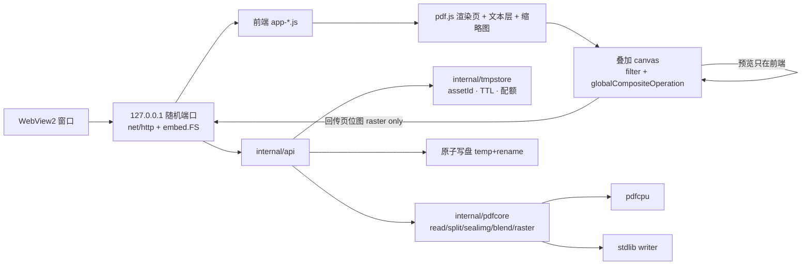

# AutoStamp — 实施计划（IMPLEMENTATION PLAN）

> 最后核对：2026-10-28。本文是唯一权威的阶段计划；每阶段完成后勾选状态并回填实测数据。
> 依赖/浏览器事实引用 `docs/FACTS.md` 编号，禁止凭记忆改写。约束见 `AGENTS.md`。

## 1. 目标 / 非目标

目标（产品需求 1–5 全量）：PDF 查看（文本/图片/混合）、透明印章叠加与调参预览、
自动切分 + 骑缝章 + 起始位置、混合模式与透明度、带分辨率/质量参数的保存。

非目标：OCR、表单编辑、PDF 结构编辑器、云同步/协作、跨平台原生窗口（Windows WebView2
优先，非 Windows 只回退系统浏览器）、移动端。

## 2. 依赖与代价（决策依据见 FACTS）

|依赖|版本|许可|用途|代价|
|---|---|---|---|---|
|`github.com/pdfcpu/pdfcpu`|v0.16.3|Apache-2.0|解析/校验/切分(Cut)/合并/印章落盘/加密|净 **+11.06 MB**（FACTS §2.5）|
|`pdfjs-dist`|6.4.299|Apache-2.0|页面渲染、文本层、缩略图、导出用位图来源|最小 2.8 MB，全量 5.98 MB（FACTS §3）|
|`github.com/jchv/go-webview2`|latest（同 TinyRouter pin）|MIT|WebView2 窗口|小（纯 Go，无 CGO）|
|stdlib + `golang.org/x/image`|—|BSD|写 PDF（Flate/DCT）、印章重采样、JPEG 质量|0|
|自写 `internal/pdfcore/blend.go`|—|—|ExtGState `/BM`（pdfcpu 不提供，FACTS §2.2）|约 150 行|
|不引入|—|—|外部 mutool/Ghostscript/qpdf（AGPL/无用）；OCR（默认关闭）|—|

预计产物：`dist/autostamp-webview-stripped.exe` ≈ 20 MB。

## 3. 架构与数据流

不变量：预览像素与落盘后再次渲染的像素一致（FACTS §1.3）；PDF 原文只读不改，
所有修改落到新 asset；写盘只在用户显式保存时发生。

## 4. 阶段

状态：`[ ]` 未开始 · `[~]` 进行中 · `[x]` 完成（并回填实测数据）

### P0 — 工程骨架 `[ ]`

目的：窗口能打开、服务能跑、配置能存、地图有落地。

交付：`go.mod`（module `autostamp`，go 1.26）、`main.go`、`host_webview_windows.go`
（`webview2.NewWithOptions` + `CoInitializeEx`/`LockOSThread` 次序照 FACTS 引用注释实现）、
`host_console.go`（回退浏览器）、`web/embed.go`、`web/static/index.html`+`app-*.js` 外壳
（页面导航/主题/双语 i18n 骨架）、`internal/app/{port.go,server.go,browser.go}`、
`internal/config`（settings.json，默认值 + 原子写 + 指针字段合并）、
`internal/tmpstore`（owner/job/配额/TTL/scavenge）、`internal/console`、
`tools/verify/`（headless 启动脚本）、`PROJECT_MAP.md`。

关键实现：`http.ServeMux` 方法路由；brotli/gzip 中间件（`Accept-Encoding` 协商，
跳过已压缩类型）；`Host`/`Origin` 校验（P7 硬化，先埋开关）；`GET /api/health`。

验收：`go build -tags webview ./... && go vet ./... && go test ./...` 全绿；
headless 打开 `http://127.0.0.1:<port>` 显示外壳、console 0 error；
settings 写盘两次不损坏（单测：中断写 → 文件完整或回滚）。

### P1 — PDF 查看（需求 1）`[ ]`

目的：打开本地 PDF，页浏览、缩略图、文本层；打通「本地文件」通道。

交付：`web/static/vendor/pdfjs/{build,cmaps,wasm,standard_fonts,image_decoders}`（提交 +
`LICENSE`/`README`/`SHA256.txt`）；`web/static/app-preview.js`（pdf.js 初始化、
`cMapUrl`/`standardFontDataUrl`/`wasmUrl` 指向 vendor 路径、页渲染 + 缩放 + 翻页）；
`app-thumbs.js`（缩略图，降采样 worker）；`app-textlayer.js`；
`internal/api/pdf.go`：`POST /api/fs/pick`（native picker）、`POST /api/pdf/open`、
`GET /api/pdf/raw`（Range/ETag）；`internal/pdfcore/read.go`（页数、每页 pt 尺寸、
rotation、是否含文字标记——由 pdf.js 抽取，服务端只做结构信息）。

关键实现：pdf.js 仅 ESM，用 `import()` 动态加载（FACTS §1.1）；
`MaxBytesHandler` 上限 256 MiB；Range 直读避免整文件进内存。

验收：三类样本（纯文字 A4、单页扫描 300dpi、混合型含图片+文字）渲染成功；
`getTextContent` 文本条数断言；中文 CID 样本渲染不断字（并把结果回填 FACTS §6）；
headless 无 console error、无 404 资产。

### P2 — 印章叠加与调参预览（需求 2、4 的预览面）`[ ]`

交付：`app-overlay.js`（双层 canvas：页 canvas + 印章 canvas）、拖拽/锚点/手柄缩放/旋转、
`app-panel.js` 控件（透明度 %、混合模式 16 项、明度、饱和度、尺寸 mm/pt、XY 数值框）、
`POST /api/pdf/seal/prepare`（上传 PNG → sealId + alpha 元数据 + 重采样
`golang.org/x/image/draw`）；印章「去白底」前端可选（存为预设时用）。

关键实现：每层 `save()/restore()` 且显式 `filter='none'`（FACTS §1.4 污染回归）；
预览 scale=2 与导出 dpi 之间允许 ±2 通道容差（抗锯齿）；
透明度百分比 = `globalAlpha`；混合模式映射到 `globalCompositeOperation`，
并在 UI 上标注对应的 PDF `/BM` 名称。

验收：`node tools/verify/pixel-matrix.mjs` 断言参考值
(170,22,28)（multiply × 无 filter）与 (189,106,119)（multiply + 0.6）；
新增「filter 未复位」回归用例必须失败→修复→通过；
16 种模式 × {1.0,0.6,0.3} 三档透明度无异常。

### P3 — 自动切分 + 骑缝章（需求 3）`[ ]`

交付：`internal/pdfcore/split.go`（`api.CutFile` + `Trim`/`ExtractPages` 剔原页）、
`sealimg.go`（条带切分 + 重采样）、`app-crosspage.js`（起始位置滑杆、每页预览条带、
装订边选择）、`POST /api/pdf/split`。

关键实现（FACTS §2.3 坑）：切点用**相对分数**；`outDir` 预创建（tmpstore 目录）；
输出含原页 → 剔除；骑缝章 = 第 i 页放第 i 条（`position:r` + `offset:0 -startOffset`），
单面=右缘连续、双面=右/左交替（§9 决策 D2）。自动切分启发式：MediaBox 纵横比
> 0.7 且横排 → 判 2 拼（`UNVERIFIED`，需样本实测回填 FACTS）。

验收：A4→A5 尺寸断言（595×842 → 297.5×842）；两页印章 bbox 断言；
预览合成后再落盘（P4 前用 stdlib writer 过渡）骑缝拼回像素与整枚印章一致（误差 ≤ 1 px）。

### P4 — 矢量落盘 + 混合模式注入（需求 4 的落盘面）`[ ]`

交付：`internal/pdfcore/blend.go`（ExtGState `/BM` + `/ca` `/CA`，幂等 `Update`）、
`validate.go`（`ValidateFile` + 显式 `MaxImageBytes`/`MaxImagePixels`）、
`POST /api/pdf/apply`、`POST /api/pdf/save`（`pathGrantId` / 目标路径 / 替换原文件，
temp+rename）、`internal/pdfcore/engine.go`（open→split→seal→save 状态机，失败回滚 asset）。

关键实现：pdfcpu 已生成 `GS0`，注入即在 GS 字典补 `/BM`；若 pdfcpu 未生成 GS 则自建字典 +
Form 内容流 `gs`（两条路径都要有单测）。加密 PDF 走 `UserPW/OwnerPW`（FACTS §2.4）。

验收：`ValidateFile` 通过；**回读一致性**：保存的 PDF 再喂 pdf.js 渲染，
采样像素 == P2 预览值（16 模式 × 3 透明度矩阵）；重复调整同一印章不叠加
（`Update` 幂等，实测已验证）；`go test ./internal/pdfcore` 全绿。

### P5 — 光栅导出与保存参数（需求 5）`[ ]`

交付：`internal/pdfcore/raster.go`（`/DCTDecode` 与 `/FlateDecode` 两条 writer，
页尺寸/DPI/旋转矩阵、`/Length` 精确）、`POST /api/pdf/export`
（`{dpi ∈ 72/150/300/custom, quality ∈ 40..95, mode ∈ vector|raster, pages}`）、
前端「导出设置」面板 + 体积预估。

关键实现：页位图由 pdf.js 按目标 scale 渲染后回传（避免服务端 rasterize，
FACTS §2.4 无该能力）；每页 X/Y DPI 元数据（`/DECODE` 由 1pt=1/72in 换算）；
超过 90 MB/页时提示并降 DPI；印章在 raster 模式下已被前端合成，无需 `/BM`。

验收：复现 FACTS §4 体积表（±5%）；导出 PDF 被 pdf.js 解析渲染采样一致；
300dpi + q92 单页 ≤ 500 KB 量级；`go test` writer 字节结构断言（xref 偏移、`/Length`）。

### P6 — 预设 / 批处理 / 打包 `[ ]`

印章预设库（`%APPDATA%\AutoStamp\seals\`：名称、图片、参数组，CRUD + 导出 zip）；
最近文件列表；**批处理**（同参数套用到多个 PDF/一个目录，队列 + 进度 SSE）；
页眉页脚/多印章（可选，若 P2 面板已支持多印章则复用）；
`build.ps1`（default/webview/strip 变体 + 版本注入 + `rsrc` 图标 exe）；
体积与冷启动实测回填本文。

验收：批处理 20 个 PDF（含混合/扫描）全成功、失败项不影响其他；exe 体积 ≤ 25 MB；
双击启动到首屏可交互 ≤ 1.5 s。

### P7 — 加固与文档核对 `[ ]`

`Host`/`Origin` 强制校验、`X-Content-Type-Options`、`CSP`（仅 self + 内联 hash 策略）；
上传/渲染内存预算与大图分块；加密 PDF 口令弹窗与失败提示；
崩溃恢复（tmpstore scavenge、崩溃后重启清空）；i18n 全覆盖；
`PROJECT_MAP.md`/`docs/*` 核对与 `docs/changelog/` 建立。

## 5. 验证约定

- Go：`go vet ./... && go test ./...`（`internal/pdfcore`、`internal/config`、
  `internal/tmpstore`、`internal/api` httptest 契约）。
- 前端：`web/*.test.js`（node、无框架、DOM 桩）+ `tools/verify/*.mjs`
  （headless Chromium：渲染采样、bbox、0 console error）。
- 每阶段至少一次真实窗口冒烟（WebView2），并记录截图到 `tmp/verify/evidence/`（gitignore）。

## 6. 里程碑顺序与依赖

P0 → P1 → P2 →（P3 ∥ P4 设计并行）→ P4 → P3 完整 → P5 → P6 → P7。
关键前置：P4 的 blend 注入是唯一自写难点（无现成依赖，FACTS §2.2），
P3 的切分几何依赖 P4 的落盘才有完整「预览→保存」闭环。

## 7. 风险与对策

|风险|影响|对策|
|---|---|---|
|pdfcpu API 命名不稳（v0.16 已把 stamp 改成 watermark 系列）|升级即断|`go.mod` 精确 pin v0.16.3；只在 `internal/pdfcore` 包一层适配；升级需跑 P4 回归矩阵|
|exe 体积（pdfcpu +11 MB、pdf.js ≈3–6 MB）|分发/杀软误报|构建期裁剪 pdf.js 资产（非扫描场景去掉 `wasm`/`image_decoders`）；发布加签名/说明|
|预览(2× scale) 与导出(300 dpi) 抗锯齿差异|像素比对波动|验证容差 ±2/通道；关键断言用整数区域|
|中文 CID / 无 `/ToUnicode` PDF 抽不出文字|文本层为空|提示「该文件无可提取文字」，不假装成功；P1 实测回填 FACTS|
|超大扫描 PDF 占用内存|卡顿/崩溃|Range 直读、分页处理、`MaxImagePixels` 收紧、raster 分页|
|骑缝章装订边定义（单面/双面）|成品顺序错|决策 D2 定死几何；预览逐页显示条带位置|

## 8. 可测量的完成标准（Definition of Done）

1. 需求 1–5 全部在真实 WebView2 窗口内可用（非 CLI、非占位）；
2. 保存后的 PDF 在外部查看器（Edge/Acrobat）中印章位置、透明度、混合模式与预览一致；
3. 数值验证矩阵全绿（P2/P4/P5 的采样断言）；
4. `go test`/`go vet`/`node tools/verify` 无失败；
5. 文档（`PROJECT_MAP.md`、`docs/*`）与代码同提交更新。

## 9. 待定决策（默认已选，改动需产品确认）

|编号|问题|推荐默认|
|---|---|---|
|D1|保存默认路径|`vector`（保留文字/可搜索），需要抗篡改时切 `raster`|
|D2|骑缝章装订边|单面打印：右缘连续条带；双面：奇数页右缘/偶数页左缘交替；页内起始偏移可调（起始位置）|
|D3|自动切分触发|MediaBox 横排且纵横比 > 0.7 才自动 2 拼；否则需用户手动指定切点|
|D4|印章去白底|前端做（红印章扫描白底常见），存预设时保留 alpha；不做服务端 OCR|
|D5|是否支持 macOS/Linux|不支持原生窗口（需 CGO），只回退浏览器；`UNVERIFIED`|
|D6|批处理并发|3（与 IO 竞争最小化），失败不中断整批|

## 10. 状态跟踪

|阶段|状态|实测数据（回填）|
|---|---|---|
|P0 骨架|`[ ]`||
|P1 查看|`[ ]`||
|P2 叠加预览|`[ ]`||
|P3 切分+骑缝|`[ ]`||
|P4 矢量落盘+BM|`[ ]`||
|P5 光栅导出|`[ ]`||
|P6 预设/批处理/打包|`[ ]`||
|P7 加固/文档|`[ ]`||
