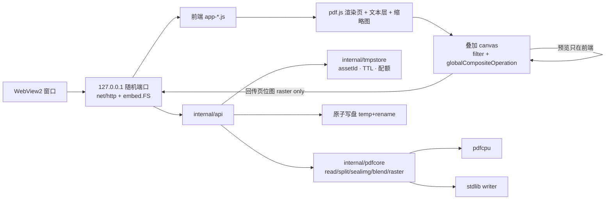

# AutoStamp — 实施计划（IMPLEMENTATION PLAN）

> 最后核对：2026-11-04（**P0–P7 全部完成**；产品需求 1–6 全在真窗口里可用；PD1/PD2 粘贴/拖拽装载 + impeccable polish = commit `7d241d3`；单 exe 出口 `build1.ps1` / UPX 极限压缩 `buildm.ps1`，FACTS §4.3；2026-11-03 顶栏收尾 = `UI_SPEC §8` HD1/HD2/HD3（顶栏精简 + 图标化、版式密度字段删除、最近文件 UI 入口删除）+ HD4（显示版本 = `0.1-dev`），commit `ff7ed61`；HD5/HD6/HD7（启动页入口 + 顶栏去文本 + 左列出血）与 V4–V6 视口 + ghost 修复（commit `79f3b83`）登记在 §10.1。**本轮 = HD8–HD12：顶栏印章通道（上传按钮 + 最近印章下拉 + 兜底删记录）、左列底部印章预览、加章模式开关、实例只作用放置页、选中实例浮动参数面板取代侧栏「叠加参数/位置与尺寸」两段**（AGENTS §5.28–§5.30；`UI_SPEC §8` HD8–HD12；i18n 270 → 265、ui-ids 89 → 91；登记在 §10.1）。出货 = `build.ps1 -Task stripped,package` 的 win64 zip）。**阶段计划已收官，当前工作模式 = 人工端到端验收 + 细节调整 + 功能细化，走 §0 第 9 条与 §10.1。**
> 依赖/浏览器事实引用 `docs/FACTS.md` 编号，禁止凭记忆改写。约束见 `AGENTS.md`。

## 0. 新对话恢复执行协议（执行入口）

1. 工作目录必须是 `C:\AutoStamp`（否则先 `/add-dir C:\AutoStamp`）。`AGENTS.md` 随仓库自动加载。
2. 依次读：`AGENTS.md`（约束）→ 本文件 **§10 状态跟踪** → `docs/FACTS.md`（实测事实）。
3. 状态表中第一个 `[ ]` 的阶段即为当前阶段；只在该阶段的「交付 / 关键实现 / 验收」范围内动手，
   不跨阶段抢做（P0 未 `[x]` 之前不动 P1）。
4. 开工前基线：`git status` 干净；已有代码时跑 `go vet ./... ; go test ./...` 记录起点是否全绿。
5. 事实（版本号、体积、参数键、切点、像素值）只允许引用 `docs/FACTS.md` 编号；
   标 `UNVERIFIED` 的必须先写探针实测、回填 FACTS（标重跑日期）再据此决策，**禁止凭记忆**。
   注意 FACTS §5：原一次性探针已删除，首次需要时重写进 `tools/verify/`。
6. 完成判据：该阶段验收命令全部通过 → 状态表勾 `[x]` + 回填实测数据 → 文档同步（`AGENTS.md` §10）。
   阶段收尾提交信息：`P<n>: <摘要>`（例 `P4: blend ExtGState 注入与回读一致性`）。
7. 卡住时优先照 §7 风险表对策做；仍不通就把实测现象写进 FACTS，而不是改需求。
8. 若当前阶段是 **P0.5（UI 契约冻结）**：先读 `docs/UI_SPEC.md` 的决策表（若已存在），
   已确认项**不得重问**；未确认项按 P0.5「与用户的交互协议」用 `ask` 批量提问
   （每轮 2–5 条、选项式），拿到用户答复才写决策表——**禁止把 §9 默认值当作已确认，
   也禁止虚构用户确认**。`UI_SPEC` 不存在时先交付 mock 再问。
9. 阶段自 2026-11-03 起全部 `[x]`：第 3 条的「当前阶段」不再存在。工作按
   **人工端到端验收（用户在真窗口操作）+ 细节调整 + 功能细化**进行，登记与流程见 §10.1。
   每项验收反馈/细化 = 先登记 §10.1 表 → 修复/实现 → 回填验证命令与实测 → 提交
   （`fix:`/`polish:`/`feat:` + 摘要）。**UI 语义/字段改动仍必须先经 `docs/UI_SPEC.md` §8
   用户确认决策行（AGENTS §8 UI 语义门槛），不得虚构确认。**

## 1. 目标 / 非目标

目标（产品需求 1–5 全量）：PDF 查看（文本/图片/混合）、透明印章叠加与调参预览、
自动切分 + 骑缝章 + 起始位置、混合模式与透明度、带分辨率/质量参数的保存。

非目标：OCR、表单编辑、PDF 结构编辑器、云同步/协作、跨平台原生窗口（Windows WebView2
优先，非 Windows 只回退系统浏览器）、移动端。

## 2. 依赖与代价（决策依据见 FACTS）

|依赖|版本|许可|用途|代价|
|---|---|---|---|---|
|`github.com/pdfcpu/pdfcpu`|v0.16.3|Apache-2.0|解析/校验/切分(Cut)/合并/印章落盘/加密|净 **+11.06 MB**（FACTS §2.5）|
|`pdfjs-dist`|6.4.299|Apache-2.0|页面渲染、文本层、缩略图、导出用位图来源|最小 2.8 MB，全量 5.98 MB（FACTS §3）|
|`github.com/jchv/go-webview2`|latest（同 TinyRouter pin）|MIT|WebView2 窗口|小（纯 Go，无 CGO）|
|stdlib + `golang.org/x/image`|—|BSD|写 PDF（Flate/DCT）、印章重采样、JPEG 质量|0|
|自写 `internal/pdfcore/blend.go`|—|—|ExtGState `/BM`（pdfcpu 不提供，FACTS §2.2）|约 150 行|
|不引入|—|—|外部 mutool/Ghostscript/qpdf（AGPL/无用）；OCR（默认关闭）|—|

预计产物：`dist/autostamp-webview-stripped.exe` ≈ 20 MB。

## 3. 架构与数据流



不变量：预览像素与落盘后再次渲染的像素一致（FACTS §1.3）；PDF 原文只读不改，
所有修改落到新 asset；写盘只在用户显式保存时发生。

## 4. 阶段

状态：`[ ]` 未开始 · `[~]` 进行中 · `[x]` 完成（并回填实测数据）

### P0 — 工程骨架 `[x]`

目的：窗口能打开、服务能跑、配置能存、地图有落地。

交付：`go.mod`（module `autostamp`，go 1.26）、`main.go`、`host_webview_windows.go`
（`webview2.NewWithOptions` + `CoInitializeEx`/`LockOSThread` 次序照 FACTS 引用注释实现）、
`host_console.go`（回退浏览器）、`web/embed.go`、`web/static/index.html`+`app-*.js` 外壳
（页面导航/主题/双语 i18n 骨架）、`internal/app/{port.go,server.go,browser.go}`、
`internal/config`（settings.json，默认值 + 原子写 + 指针字段合并）、
`internal/tmpstore`（owner/job/配额/TTL/scavenge）、`internal/console`、
`tools/verify/`（headless 启动脚本）、`PROJECT_MAP.md`。

关键实现：`http.ServeMux` 方法路由；brotli/gzip 中间件（`Accept-Encoding` 协商，
跳过已压缩类型）；`Host`/`Origin` 校验（P7 硬化，先埋开关）；`GET /api/health`。

验收：`go build -tags webview ./... && go vet ./... && go test ./...` 全绿；
headless 打开 `http://127.0.0.1:<port>` 显示外壳、console 0 error；
settings 写盘两次不损坏（单测：中断写 → 文件完整或回滚）。

实测（2026-10-29）：

- `go vet ./...` + `go test ./...` 全绿（Go 测试 46 个：`web` 4 / `api` 8 / `app` 10 /
  `config` 12 / `fsx` 5 / `tmpstore` 7 / `console` 3）。
- `node tools/verify/shell-smoke.mjs`：**真二进制 + headless Chromium**，沙箱化
  `%APPDATA%`/`%LOCALAPPDATA%`，console 0 error、无 404，外壳契约 id=79 / 字段=44 /
  状态=12；`/api/health` 返回版本三元组，`POST /api/settings` 的 `{"patch":…}` 合并
  只改送来的字段（越界值 clamp + `warning`）。
- `node tools/verify/webview-launch.mjs`：`-tags webview` 真窗口打开并页内完成
  `/api/health`+`/api/settings`；COM `CoInitializeEx` 实测返回 `S_FALSE`（FACTS §1.6）。
- 体积：控制台 strip 6,912,512 B；WebView2 strip 7,345,152 B（FACTS §4.1）。
- 落地文件见 `PROJECT_MAP.md`；`internal/pdfcore` 未创建（P2-P5）。

### P0.5 — UI 契约冻结：与用户交互确定 UI `[x]`

目的：在写任何功能接线之前，用可交互 mock **和用户一起**把 UI 语义、参数词表、
预览形态定死，使 P1–P5 只替换数据源、不重写 DOM/契约。这是需求侧唯一「必须先问用户」
的阶段——§9 的 D2/D3/D4 只有 UI 才能表达清楚。

前置：无（不依赖 Go 骨架，可与 P0 并行开跑）。但 **P1 开工前 P0.5 必须 `[x]`**，
且 P0 的 `web/static/index.html` 外壳必须按 `UI_SPEC` 的 DOM 骨架与 id 命名搭建。

交付：

- `docs/ui/mockup.html`：standalone HTML（内联 CSS/JS，无第三方依赖、无构建），
  真 DOM + 真 CSS token（与 `style.css` 同一套变量），假数据驱动。
  **只存在于 `docs/ui/`：不进 `web/static/`、不进 `embed.FS`、不进 exe。**
  必须覆盖的状态：无文件空态、已开 PDF、选中印章实例、拖拽/缩放开手柄、
  骑缝章模式（逐页条带 + 起始位置滑杆 + 单面/双面切换）、导出面板（DPI/质量 +
  实时体积预估，数值取 `docs/FACTS.md` §4）、保存/替换原文件的二次确认、错误态。
- `docs/ui/fixtures/{page.png,seal.png}`：由 `tools/genfix/main.go`（stdlib `image/png`，
  带 alpha 的红色 RGBA 印章 + 灰底带文字块的 A4 页位图）生成——避免依赖尚未实现的 P1。
- `docs/UI_SPEC.md`：①组件层级与状态机（asset → 页选择 → 印章实例 → 骑缝章 → 导出/保存）
  ②参数词表（字段名、类型、取值域、单位 pt/mm/%、默认值、是否可空）③控件 ↔ 字段绑定表
  ④空态/禁用态/错误态文案（列 i18n key）⑤快捷键 ⑥决策表（D1–D4 + 布局与预览形态，
  每行含「用户确认」列）⑦与 `AGENTS.md` §6 路由字段的对照表。
- `tools/verify/ui-smoke.mjs`、`tools/verify/ui-contract.mjs`（三方一致性校验：
  mock 的 `data-field` 属性 ↔ `UI_SPEC` 字段表 ↔ `AGENTS.md` §6 请求字段；不一致即退出报错）。

与用户的交互协议（**不得替用户虚构确认**，也不得把这些默认值直接当已确认）：

1. 先交付 mock（浏览器打开，用户可点、可拖、可切模式），再用 `ask` 批量提问：
   每轮 2–5 条、选项式、每条附 mock 里对应的 state 名。首轮必问：
   **D2 装订边**（单面右缘连续 / 双面奇右偶左 / 二者可选切换）、
   **D3 自动切分**（自动判定 + 一键否决 / 仅手动指定切点 / 自动但可覆盖）、
   **D4 去白底**（预览即时可撤销 / 仅在保存预设时处理 / 不做）、
   布局密度（左预览+右面板 / 单栏上下 / 面板可折叠）、
   骑缝章预览形态（逐页条带缩略图 / 主画布叠加 + 侧栏放大）。
2. 用户选定后**立即**写进 `UI_SPEC` 决策表（选项文本 + 确认日期 + 引自 ask 的原文摘要），
   并把 mock 默认 state 改为所选；再进入下一轮（第 2 轮：保存/替换语义、体积预估展示、
   错误态文案、多印章实例的命名与列表形态）。
3. 最多 3 轮；2 轮内收敛。仍决不了的按 §9 默认实现，在 `UI_SPEC` 标 `未评审默认`
   （不得留 `TODO`、不得空着）。
4. 每轮结束把「已确认字段 + 相对上轮的变更」摘要回贴用户；已确认项在后续会话中不得重问。

关键实现：mock 的 DOM 骨架即 P0/P1 的真实外壳（容器/画布/面板 id 就是契约的一部分）；
每个可调参数在 mock 里挂 `data-field="<§6 字段名>"`，接线时只换渲染与请求代码。
16 种混合模式在 mock 里必须是**分组选择器**（Normal / 增亮 / 增暗 / 比较 / 分量组），
不许 16 个平铺按钮；透明度、明度、饱和度统一滑杆 + 数值框（滑杆与数值双向绑定）。

验收：

- `node tools/verify/ui-smoke.mjs`：mock 打开 console 0 error、无 404；
  1280×720 与 1440×900 无横向溢出；每个控件都带 i18n key 且 en/cn 两值非空。
- `node tools/verify/ui-contract.mjs`：三方字段一致性通过（mock ↔ `UI_SPEC` ↔ §6）。
- `UI_SPEC` 决策表 D1–D4 与预览形态、布局密度各有用户确认记录（日期 + 所选选项 + 原文摘要）。
- `docs/IMPLEMENTATION_PLAN.md` §9 对应行改为「已在 P0.5 确认」并指向 `UI_SPEC` 行号。

实测（2026-10-29）：`ui-contract` → mock fields=39 / spec fields=44 / i18n=190 /
states=15 / ids=75 / routes=11（OK）；`ui-smoke` → states=15 i18nKeys=170
consoleErrors=0（OK）。决策表：D1-D4、L1、CP1、I1、S1 全部有用户确认记录
（2026-10-29，ask 第 1/2 轮，`UI_SPEC §8`）。§9 的 D2/D3/D4 行已改为「已在 P0.5 确认」。
### P1 — PDF 查看（需求 1）`[x]`（2026-10-29 实测通过，数据见本节末）

目的：打开本地 PDF，页浏览、缩略图、文本层；打通「本地文件」通道。

交付（实际落地名）：`web/static/vendor/pdfjs/*`（提交 + `LICENSE`/`README`/`SHA256.txt`）；
`web/static/app-preview.js`（pdf.js 懒 `import()`、`cMapUrl`/`standardFontDataUrl`/`wasmUrl`、
单页渲染 + fit/zoom + 翻页 + `sample()` 像素探针）；`web/static/app-textlayer.js`；
`web/static/app-pager.js`（分页 chip + **chip 内缩略图**，`UI_SPEC §8` V2；不是早期的
`app-thumbs.js` 独立侧栏方案）；`internal/api/pdf.go`：`POST /api/fs/pick`（含 `filePath`
直开授权）、`POST /api/pdf/open`、`GET /api/pdf/raw`（Range/ETag）；
`internal/webx/session.go`（会话令牌即 capability）；`internal/fsx/pick*.go`
（PowerShell `Forms+FileDialog`，非 Windows 回 501）；`internal/pdfcore/read.go`
（pdfcpu 结构信息：页数 / 每页 pt 尺寸 / rotation / `hasFonts`——文本抽取仍由 pdf.js 做）。

资产获取（本机 2026-10-28 实测可行：`npm pack` 得 `pdfjs-dist-6.4.299.tgz`
8,539,589 B；node v24.18.0 / npm 11.16.0）：

```bash
mkdir -p tmp/asset && cd tmp/asset && npm pack pdfjs-dist@6.4.299
tar -xzf pdfjs-dist-6.4.299.tgz                       # → package/
mkdir -p web/static/vendor/pdfjs/build
cp package/build/pdf.min.mjs package/build/pdf.worker.min.mjs \
   web/static/vendor/pdfjs/build/
cp -r package/cmaps package/wasm package/image_decoders package/standard_fonts \
   web/static/vendor/pdfjs/
cp package/LICENSE web/static/vendor/pdfjs/LICENSE
sha256sum web/static/vendor/pdfjs/build/*.mjs > web/static/vendor/pdfjs/SHA256.txt
# 另写 web/static/vendor/pdfjs/README.md：来源 tarball 名+版本+用途+当前裁剪状态
rm -rf tmp/asset                                      # 清理；tmp/ 已 gitignore
```

P1 先 vendor **全量**（≈5.98 MB，FACTS §3）以保证扫描型样本的 JBIG2/JPX 可渲染；
发布期裁剪（`wasm`/`image_decoders`/`standard_fonts`）留到 P6 用实测样本决定，
裁剪后 exe 体积必须回填 §10。PowerShell 下 `tar` 为 bsdtar 等价；`sha256sum`
不可用时改 `Get-FileHash`。

关键实现：pdf.js 仅 ESM，用 `import()` 动态加载（FACTS §1.1）；
`MaxBytesHandler` 上限 256 MiB；Range 直读避免整文件进内存。

验收：四类样本（英文多页文字、中文 CID 文字、混合型、图片型无文字）渲染成功；
`getTextContent` 文本条数断言；中文样本渲染不断字（结果已回填 FACTS §1.7/§6）；
headless 无 console error、无 404 资产。

P1 实测（2026-10-29，`powershell -File build.ps1 -Task all` → 失败 0）：

- 样本由 CDP `Page.printToPDF` 现场生成（不落仓库）：英文 5 页 54,763 B / 中文 4 页
  186,950 B / 混合型 23,935 B / 图片型 3 页 46,043 B；真 exe + 真 UI（空态
`#empty-path` 的回车通道，HD6）跑通，断言脚本 `tools/verify/preview-smoke.mjs`。
- fit：1440×900 下 A4（595.3×841.9 pt）fit=1.671；切 single-col 后 2.309；
  ResizeObserver 在容器宽变化后重算 ✓（缩放态下只刷新 fit 注记，不重画）。
- 文本层：英文 spans 3 / 中文 spans 24 / 混合 spans 1 / 图片型 0；层框宽与画布
  CSS 宽一致（drift 0，`OutputScale.pixelRatio`=1.25，FACTS §1.7）。
- 主画布像素：英文 ink 6,408 / 中文 9,574 / 混合 107,443 / 图片 322,655。
- 分页 chip 数 == 页数（5/4/1/3）；chip 内缩略图 alpha 全覆盖（dpr 1 时 40×56，
  文字页字形在该尺寸下亚像素 → ink≈0，见 FACTS §1.7）。
- 会话边界：`/api/pdf/raw` 不带 `X-AutoStamp-Session` → 400；带令牌 → 200 +
  `application/pdf`；`Range: bytes=0-63` → 206 / 64 B（pdf.js 用 `httpHeaders` 带令牌）。
- `go vet`/`go test ./...` 全绿；`webview-launch.mjs` 真窗口 + 页内 `/api` ✓；
  console 0 error、0 失败请求。
- vendor：`SHA256.txt` 206 项（README 改动后需重生成），`TestVendorChecksums` 复核 ✓。

### P2 — 印章叠加与调参预览（需求 2、4 的预览面）`[x]`（2026-10-30 实测通过，数据见本节末）

交付：`app-overlay.js`（双层 canvas：页 canvas + 印章 canvas）、拖拽/锚点/手柄缩放/旋转、
`app-panel.js` 控件（透明度 %、混合模式 16 项、明度、饱和度、尺寸 mm/pt、XY 数值框）、
`POST /api/pdf/seal/prepare`（上传 PNG → sealId + alpha 元数据 + 重采样
`golang.org/x/image/draw`）；印章「去白底」前端可选（存为预设时用）。

关键实现：每层 `save()/restore()` 且显式 `filter='none'`（FACTS §1.4 污染回归）；
预览 scale=2 与导出 dpi 之间允许 ±2 通道容差（抗锯齿）；
透明度百分比 = `globalAlpha`；混合模式映射到 `globalCompositeOperation`，
并在 UI 上标注对应的 PDF `/BM` 名称。

验收：`node tools/verify/pixel-matrix.mjs` 断言参考值
(170,22,28)（multiply × 无 filter）与 (189,106,119)（multiply + 0.6）；
新增「filter 未复位」回归用例必须失败→修复→通过；
16 种模式 × {1.0,0.6,0.3} 三档透明度无异常。

实测（2026-10-30，`node tools/verify/overlay-smoke.mjs`（真 exe + 真 UI + headless，
分段令牌 `--only=<open,geometry,despill,drag,strip,filter,export>`）+
`powershell -NoProfile -File build.ps1 -Task vet,test,verify` → 失败 0 / 跳过 0）：

- 交付实际落地：`web/static/app-seal.js`（`/api/pdf/seal/prepare` 上传通道、选项
  `seal.prepare.*`、`revert()` = 用内存原图重跑 `despill:false`）、
  `web/static/app-overlay.js`（页 canvas 合成 + DOM affordance）、`app-shell.js`
  的实例/印章通道（`sealIdFor` / `restoreInstanceSeals` / `applyTo` /
  `stamp-layer`）、`app-preview.js` 的 `state.snapshot` + `overlay.paint` 串接。
  **不再需要** `app-panel.js` / `app-crosspage.js`（面板与骑缝预览已在 P0.5 壳里，
  切分预览在 `app-preview.js`）。
- 印章通道实测：600x600 alpha PNG（402,338 B）→ `sealId seal-922120f3`，
  meta `600x600 / alpha 76% / bbox 6..594 / 353.19 pt @150dpi`，去白底后
  353x353 pt（62,926 B）；fixture `seal.png` 400x400：alpha 22%（未去背）→
  36%（去背后）。alpha=89 的半透明样本在 16 模式矩阵里精确落在
  `dst*(1-a)+(premult*255)*a` 上（见 FACTS §1.3/§1.8）。
- 16 模式 × {1.0,0.6,0.3}（脚本内同算法独立重算一遍，不是只比上一轮）：全部
  `absdiff ≤ 1`，`multiply` 参考点仍 == FACTS §1.3（170,22,28）；
  印章 alpha 规则与 `soft-light` 用 W3C 分段公式（FACTS §1.2）。
- 几何：fit-zoom 下 90x90 pt 实例 == 页框 0.2 倍 ✓；四角手柄拖拽 →
  `apply.scale` 增长 ✓；中心拖拽 → `api.apply.offset = (58,627)`（页坐标）✓；
  旋转手柄（顶边中点上方）→ `apply.rotation` ✓；滚轮只在**光标位于选中实例上**时
  改 `scale`，且不冒泡出画布（V3，见 UI_SPEC §8 V3）。
- 骑缝条带：单边 `right` = 每页 1 条，宽 = 页宽 10%（实测 45.8 pt）✓；
  `startOffset` 40/120 → y 位移**精确等于**字段值（误差 0）✓ 且不改宽度 ✓；
  `alternate` = 奇右偶左，条带数 == 页数 ✓；四页条带按页渐变取色，逐页采样
  与「整枚印章切四刀」逐列对齐（≤1 px）✓；`binding=none` → 0 条 ✓；
  `pages=1,3` → 第 2 页无条带 ✓；骑缝实例隐藏手柄、拒绝画布拖拽 ✓。
- 导出体积预估（UI_SPEC E1）：raster 150dpi q75 每页 == FACTS §4 的 123,796 B
  （±2%）；300/150 比值 == 3.06（±0.12）；q40 行 == 328,844 B（±2%）；
  自定义 200dpi 落在 150/300 行之间 ✓；`pages="2-4"` → 3 页 ✓；
  vector 模式**完全忽略** DPI/质量 ✓；滑杆与数值框同值（step 对齐 40+5n）✓。
- `ctx.filter` 污染回归（FACTS §1.4）：叠加层之后读数 `none` ✓ 两个实例仍 ✓。
- 全程 console 0 error、网络失败 0；`ui-contract` / `ui-smoke` / `shell-smoke`
  同步绿（ids=82 fields=44 states=12；i18n 196 键三方一致）。

### P3 — 自动切分 + 骑缝章（需求 3）`[x]`（切分 + 骑缝落盘都绿，2026-11-02）

**已实测的半边（2026-10-29）**：`internal/pdfcore/split.go` 词表 `auto/rows-cols/custom/unsplit`
+ `splitVeto`（指针，`false` 是真答案），切点=相对分数，`outDir` 用 tmpstore 目录，
`SplitOnePage` 剔掉 pdfcpu 附带的原页，`MergeCreateFile` 合并回一个 PDF；
`POST /api/pdf/split` → 新 assetId（kind `split`）+ 与 open 相同形状的页元数据，
**原资产不动**（UI 的「撤销切分」= 换回旧 assetId，不需要 undo 栈）。
A4 `Vert:0.5` → 两块 297.5x842；`/Rotate 90` 的页切出 421x595（实测见 FACTS §2.3）。
永久断言：`internal/pdfcore.TestSplit*` + `internal/api.TestSplitRoute*`（含 405→400 词表校验、
owner 边界、原资产仍可读回）。

**真实形态（不是新文件 `app-crosspage.js`）**：骑缝预览在 `app-overlay.js`
（`stripGeometryFor`/`stripRectsFor`：逐页一条、装订边 right/alternate、`startOffset`），
词表接线在 `app-shell.js`（`crosspage.*` 字段 + `#split-veto`/`#split-pages` 按钮）；
落盘在 `pdfcore.Strips` + `apply.go`（逐页第 i 条，`startOffset` 位移）。
实测：P2 的 `overlay-smoke --only=strip`（预览半边）+ P4 的
`apply-smoke --only=strip`（落盘半边，两页半枚色 Δ 0）。

关键实现（FACTS §2.3 坑）：切点用**相对分数**；`outDir` 预创建（tmpstore 目录）；
输出含原页 → `SplitOnePage` 剔除；`sortByPageTail` 按名内页号升序 = reading order
（骑缝章条带顺序依赖它）。骑缝落盘已实现：`pdfcore.Strips(png,count)` 按列切印章，
第 i 页放第 i 条（`StampGeom.CrossPage` + `Binding` + `StartOffset`，D2 单面右缘连续、
双面右/左交替），落盘框的**纵横比取自整枚印章**（FACTS §2.6）。自动切分启发式
**已实测**：`w>h` 且 `w/h>0.7` 判 2 拼（`PageIsSpread` + `TestSplitAutoCutsRotatedSpreadOnly`）；
真实扫描样本的版面判定仍 `UNVERIFIED`（FACTS §6）。

验收：~~A4→A5 尺寸断言~~ v（`internal/api.TestSplitRouteReportsCutPageSizes` +
`internal/pdfcore.TestSplitA4ToHalves`）；~~两页印章 bbox 断言 + 骑缝拼回像素 <=1px~~ v
（2026-11-02：`apply-smoke --only=strip` 逐页半枚色 Δ 0、条带 bbox 四边 <=1 pt；
Go 侧 `TestStampStripBoxUsesWholeSealAspect` 钉住写入的 `cm` 数字）。
自动版面判定（`auto`）仍是启发式，真实扫描样本 `UNVERIFIED`（FACTS §6）。

### P4 — 矢量落盘 + 混合模式注入（需求 4 的落盘面）`[x]`

交付：`internal/pdfcore/blend.go`（ExtGState `/BM` + `/ca` `/CA`，幂等 `Update`）、
`validate.go`（`ValidateFile` + 显式 `MaxImageBytes`/`MaxImagePixels`）、
`POST /api/pdf/apply`、`POST /api/pdf/save`（`pathGrantId` / 目标路径 / 替换原文件，
temp+rename）、`internal/pdfcore/engine.go`（open→split→seal→save 状态机，失败回滚 asset）。

**engine.go 的偏离（2026-11-02 决定）**：不在服务端加一层 open→split→seal→save 状态机。
理由：这条链的状态已经在 `tmpstore` 资产里（`open`/`split`/`applied`/`exported` 各是
一个只读资产，链上关系由前端 `probe('chain')` 的 5 个 asset id 与 `undo` 路由表达），
「失败回滚」= 每条路由**先 Validate/写完再注册**，失败删临时文件（`apply.go` 的
`os.Remove(tmpPath)`、`save.go` 的 `AtomicWriteFunc`），资产要么完整存在要么不存在 ——
已由 `TestApplyRoute*`/`TestSaveRoute*` + `apply-smoke --only=chain|undo` 钉住。再写一个
Go 侧状态机会是第二事实来源。

关键实现：pdfcpu 已生成 `GS0`，注入即在 GS 字典补 `/BM`；若 pdfcpu 未生成 GS 则自建字典 +
Form 内容流 `gs`（两条路径都要有单测）。加密 PDF 走 `UserPW/OwnerPW`（FACTS §2.4）。

验收：~~`ValidateFile` 通过~~ v（`apply.go` 注册前跑 `pdfcore.Validate`，失败 500
`validate_failed` + 删临时文件；`TestApplyRouteWritesSealedFile` 断）；**回读一致性**
~~保存的 PDF 再喂 pdf.js 渲染,采样像素 == P2 预览值~~ v —— 2026-11-02 实测
**48 组（16 模式 x {1.0,0.6,0.3}）最大 Δ = 2**（@ hard-light x 0.6，阈值 <=2），
`tools/verify/apply-smoke.mjs --only=matrix`；`--only=strip` 钉骑缝落盘（两页各一条、
按切分顺序对应印章左右半、条带 59.50x59.50 pt、右缘 x ∈ [535.5,595.0]、y ∈ [40,99.5]，
四边 <=1 pt，框外 2 pt 是底，Δ 0）；~~重复调整同一印章不叠加~~ v（pdfcpu `Update` 幂等，
`TestStampKeepsAppearanceSeparateOnOnePage` + P2 已实测）；
`go test ./internal/pdfcore` 全绿 v（含 `TestStampStripBoxUsesWholeSealAspect`，
变异试验确认它抓得住条带框比写错的情况）。

### P5 — 光栅导出与保存参数（需求 5）`[x]`

交付：`internal/pdfcore/raster.go`（`/DCTDecode` 与 `/FlateDecode` 两条 writer，
页尺寸/DPI/旋转矩阵、`/Length` 精确）、`POST /api/pdf/export`
（`{dpi ∈ 72/150/300/custom, quality ∈ 40..95, mode ∈ vector|raster, pages}`）、
前端「导出设置」面板 + 体积预估。

关键实现（实测 2026-11-02）：页位图由**前端** pdf.js 按 `scale = dpi/72` 渲染后回传
（服务端无 rasterize，FACTS §2.4），**JPEG 字节直传** `/DCTDecode` 不重编码；页 pt =
`px*72/dpi`（`ptString`，两位小数）、**不加旋转量**（pdf.js 输出的就是显示方向，AGENTS §5.17
同理）；vector 半边只按 `pdfcore.ParsePages` 裁页（`pages=all` 原样克隆）——
实测：契约提名的 `api.ExtractPagesFile` 产的是「每页一个单页文件」，产不出单个子集资产，
所以子集走 `api.Trim`；W6 的 90 MB/页由前端按体积预估**提交前**拦下（`warn.export.tooBig`），
服务端仍留硬限 400 `page_too_large`。
  **保存幂等**:文档已是光栅化 asset 且 `dpi/质量/pages` 未变时第二次保存不再光栅化
  (`app-shell` 的 `lastExport`),否则就是多一代 JPEG 画质损失。

验收：~~复现 FACTS §4 体积表（±5%）~~ —— **±5% 钉不住，已改成量级**：真链路实测
`bytesPerPage` = 141,139/143,019 B，导出文件 285,313 B，落在 150dpi q75 行的 ±40% 带
[148,555, 346,629] 内；表值本身是 Go 编码的合成图（探针重跑 89,400 B），前端是 Chromium
JPEG 编码器，两者本来不会对齐（FACTS §4）。~~导出 PDF 被 pdf.js 解析渲染采样一致~~ v
（回读同点 (201,23,28) vs 导出前 (200,24,28)，Δ ≤6；页 pt Δ 0.000）；
~~300dpi + q92 单页 ≤ 500 KB 量级~~ 未跑（`UNVERIFIED`，矩阵样本只测 150dpi）；
`go test` writer 字节结构断言 v（xref 逐项指向 `N 0 obj`、`/Length` == 字节数、
DCT 流 == 输入原始字节、Flate 解压长度 `h*(1+w*3)`、`/SMask` 存在性；
`TestRasterWriterPassesPdfcpuValidate` 说明 pdfcpu 也 Validate 过手写 PDF）。
- `export-smoke --only=chain` 钉保存幂等:二次保存(同一 spec)export 请求 0 次、
  改 `quality/pages` 后重光栅化恰好 1 次 + 新 export asset。

### P6 — 预设 / 批处理 / 打包 `[x]`

交付（实现形态见 AGENTS §5.20–§5.22 与 `UI_SPEC §8` P6 决策表）：

- **印章预设库**：`internal/presetstore`（索引 `presets.json` + `p-<hash>.png`，
  同名 = 覆盖）+ 四条路由（list / save / delete / raw）+ 前端 存/载/删/列表。
  预设带 `apply.*` + `seal.prepare.*`，后端 `validatePresetParams` 先校验再存
  ⇒ 预设里的参数一定能过 `apply` 词表。**原计划的「预设导出 zip」未采纳**
  （不在产品需求 1–5 内、无用户确认记录）。
- **最近文件**（RF1）：后端就是 `config.RecentFiles`（`SetRecent` 去重 + 截断到 24 条），没有新路由、
  没有新字段。**两个 UI 入口（启动页列表 + 顶栏下拉）已于 2026-11-03 按用户指令删除**（顶栏收尾，
  见 §10.1 与 `UI_SPEC §8` HD1）：数据继续记录，界面上不再展示。
- **批处理 = 前端逐文件跑链**（BM1 取代 BC1 的「服务端串行作业 + SSE」）：
  `fs/pick{dir:true}` → `open` →（`split`）→ `apply` → `export`(raster) → `save{mkdirs}`；
  因为走的是光栅导出，`api.batch.dpi/customDpi/quality` **真生效**（改口径的动机）。
  输出 `源目录\_batch\原名.dpi<数字>.q<数字>.pdf`（BM2）；加密件跳过记
  `password_required`（BM4）；报表 + CSV/JSON 由前端生成（需求 9，不发请求）。
- **打包**（PC1）：`build.ps1 -Task package` → `dist\autostamp-<rev>-win64.zip`
  （`autostamp.exe` + `README.md`，带 25 MB 体积门）。**原计划的 `rsrc` 图标 exe 未采纳**
  （要引外部工具，违背单依赖策略）。页眉页脚/多印章按 OP1 不采纳（多印章已由 P2 多实例覆盖）。

验收实测（2026-11-03，`node tools/verify/batch-smoke.mjs --only=<preset|batch>`）：

- 预设：真 UI 存 → 两个 select 都出现 → 载入写回面板参数 → 删除后列表空。
- 批处理 **22 份**（20 份可盖，页数不一 + 1 份 AES-256 加密 + 1 份故意坏）：
  报表计数 `[22, 20, 1, 1]`、状态分布 `{ok:20, encrypted:1, fail:1}`；
  20 份产物 `_batch\b-XX.dpi150.q75.pdf` 全在且页数与源一致（2/1/1…）；
  **源文件 sha1 一字节没动**；加密与坏文件没有产物；加密行带 `password_required`
  且不弹密码；CSV 22 行（只有 ok 行带 `_batch`）+ JSON 22 条（真下载，不发请求）。
- AES-256 密码链路：`TestOpenPasswordRoundTrip`（无密码 ⇒ `password_required`；
  错密码 ⇒ `password_invalid`；userPW / ownerPW 都开成功）→ FACTS §2.8 消项。
- `go vet` + `go test ./...` 全绿；`build.ps1 -Task vet,test,verify` **失败 0 / 跳过 0**（十脚本）。
- exe 体积 **19,744 KB**（≈19.3 MB，PC1 上限 25 MB ✓）；zip 8,183 KB。
- 窗口版冷启动（出货件 `autostamp-webview-stripped.exe`）：
  `webview window opened` **514 ms**、首个 `/api/health` **555 ms**（判据 ≤ 1.5 s ✓）。
  口径 = 进程 spawn → 窗口创建并导航 + 首个 HTTP 应答，不是「肉眼双击到首屏」的计时。

### P7 — 加固与文档核对 `[x]`

实测（2026-11-03，`build.ps1 -Task vet,test,verify` = **失败 0 / 跳过 0**，十脚本 + 真窗口）：

- **Origin 出货默认开**：`config.Default().Security.StrictOrigin = true`（仍可 `PATCH` 关）。
  非 `GET`/`HEAD` 且 Origin 非本机 → 403 `bad_origin`；不带 Origin（curl / Go 测试）不受影响；
  读动词不查 Origin。**关键证据**：十脚本真 UI 全链仍在默认开的情况下跑通（浏览器同源
  `fetch` 都带正确 Origin ⇒ 出货口径没有打断真实链路）。断言 `TestMiddlewareOriginSwitch`。
- **每个响应带 `X-Content-Type-Options: nosniff`**（含 4xx/5xx 信封）：新增中间件
  `securityHeaders` + `TestMiddlewareSetsNosniffEverywhere`（API / 静态 / 403 三种都钉）。
- **CSP**（`web/embed.go`，`web/embed_test.go` 逐条断言 + 「壳无内联 `<script>`」）：
  `script-src 'self'`、`style-src 'self' 'unsafe-inline'`（CSSOM 实测 FACTS §1.5）、
  `frame-ancestors 'none'`、`object-src 'none'`、`base-uri 'none'`、`form-action 'self'`。
  **原计划的「内联 hash 策略」不成立**：前端根本没有内联脚本可放行，`'self'` 已经更强。
- **内存预算**：上传口 `MaxBytesHandler`（open 256 MiB / seal 20 MiB / export body
  = 90 MiB × 200 页，单页位图硬上限 90 MiB ⇒ 超了 400 `page_too_large`，前端 W6 先拦）；
  光栅词表 dpi 96..600、quality 40..95、页数 ≤ 200、`exportTimeout` 5 min；
  pdfcpu 护栏显式收紧 `MaxImageBytes = 64 MB`、`MaxImagePixels = 50 MP`（`pdfcore.DefaultLimits`）；
  会话存储自己的单文件/总量配额（256 MiB / 2 GiB）。
  「大图分块」= 前端逐页渲染回传（无服务端 rasterize，FACTS §2.4）+ 上面这些上限。
- **崩溃恢复**：`tmpstore.New` 启动即 `Scavenge()`（过期资产 + 任何被中断写留下的孤儿
  temp 文件）；窗口 goroutine panic 转储 `%LOCALAPPDATA%\AutoStamp\crash\`。
- **i18n 全覆盖**：276 键 en/cn（`ui-contract` 三方 + `ui-smoke` 断言），唯一来源 `UI_SPEC §4`。
- **加密 PDF 口令**：单文件走链有密码弹窗（`password_required` / `password_invalid`），
  批处理按 BM4 跳过不弹（FACTS §2.8 实测）。
- **文档核对**：AGENTS / FACTS / UI_SPEC / PROJECT_MAP / IMPLEMENTATION_PLAN / changelog
   全部同步；`README.md` 之前还写着「尚未开始 P0，无源码可构建」—— 已重写成当前事实
  （它是 zip 里的出货说明）。

## 5. 验证约定

- Go：`go vet ./... && go test ./...`（`internal/pdfcore`、`internal/config`、
  `internal/tmpstore`、`internal/api` httptest 契约）。
- 前端：`web/*.test.js`（node、无框架、DOM 桩）+ `tools/verify/*.mjs`
  （headless Chromium：渲染采样、bbox、0 console error）。
- UI 契约（P0.5 起常驻回归）：`node tools/verify/ui-smoke.mjs`（0 error、无横向溢出、
  i18n 覆盖）与 `node tools/verify/ui-contract.mjs`（mock ↔ `UI_SPEC` ↔ `AGENTS.md` §6
  字段三方一致）。
- 每阶段至少一次真实窗口冒烟（WebView2），并记录截图到 `tmp/verify/evidence/`（gitignore）。

## 6. 里程碑顺序与依赖

P0（骨架）∥ P0.5（UI 契约冻结）→ P1 → P2 →（P3 ∥ P4 设计并行）→ P4 → P3 完整 → P5 → P6 → P7。
P0.5 与 P0 可并行开跑，但 **P1 开工前 P0.5 必须 `[x]`**；P0 的 `index.html` 外壳按
`UI_SPEC` 的 DOM 骨架与 id 命名搭建，避免二次改壳。
关键前置：P4 的 blend 注入是唯一自写难点（无现成依赖，FACTS §2.2），
P3 的切分几何依赖 P4 的落盘才有完整「预览→保存」闭环。

## 7. 风险与对策

|风险|影响|对策|
|---|---|---|
|pdfcpu API 命名不稳（v0.16 已把 stamp 改成 watermark 系列）|升级即断|`go.mod` 精确 pin v0.16.3；只在 `internal/pdfcore` 包一层适配；升级需跑 P4 回归矩阵|
|exe 体积（pdfcpu +11 MB、pdf.js ≈3–6 MB）|分发/杀软误报|构建期裁剪 pdf.js 资产（非扫描场景去掉 `wasm`/`image_decoders`）；发布加签名/说明|
|预览(2× scale) 与导出(300 dpi) 抗锯齿差异|像素比对波动|验证容差 ±2/通道；关键断言用整数区域|
|中文 CID / 无 `/ToUnicode` PDF 抽不出文字|文本层为空|提示「该文件无可提取文字」，不假装成功；P1 实测回填 FACTS|
|超大扫描 PDF 占用内存|卡顿/崩溃|Range 直读、分页处理、`MaxImagePixels` 收紧、raster 分页|
|骑缝章装订边定义（单面/双面）|成品顺序错|P0.5 与用户确认（D2）后定死几何；预览逐页显示条带位置|
|UI 契约在 P0.5 之后漂移（字段名/预览形态/语义）|P1–P5 返工、用户可见语义混乱|`ui-contract.mjs` 三方校验常驻；任何字段变更必须先改 `UI_SPEC` + `AGENTS.md` §6 再改代码|

## 8. 可测量的完成标准（Definition of Done）

1. 需求 1–5 全部在真实 WebView2 窗口内可用（非 CLI、非占位）；
2. 保存后的 PDF 在外部查看器（Edge/Acrobat）中印章位置、透明度、混合模式与预览一致；
3. 数值验证矩阵全绿（P2/P4/P5 的采样断言）；
4. `go test`/`go vet`/`node tools/verify` 无失败；
5. 文档（`PROJECT_MAP.md`、`docs/*`）与代码同提交更新。
6. P0.5 之后：`docs/UI_SPEC.md` 字段表与 `AGENTS.md` §6 一致，且
   `node tools/verify/ui-contract.mjs` 三方校验（mock ↔ `UI_SPEC` ↔ §6）通过。

## 9. 待定决策（P0.5 与用户确认后回填「确认」列）

|编号|问题|推荐默认|确认（P0.5）|
|---|---|---|---|
|D1|保存默认路径|`vector`（保留文字/可搜索），需要抗篡改时切 `raster`|已确认 2026-10-29：vector → `UI_SPEC` §8 行 396|
|D2|骑缝章装订边|单面：右缘连续条带；双面：奇右偶左交替；页内起始偏移可调|已确认 2026-10-29：三档 right / alternate / none（无骑缝章），`left` 不采纳 → `UI_SPEC` §8 行 397|
|D3|自动切分触发|MediaBox 横排且纵横比 > 0.7 才自动 2 拼；否则手动指定切点|已确认 2026-10-29：自动判定 + 逐页 veto → `UI_SPEC` §8 行 398|
|D4|印章去白底|前端做（红印章扫描白底常见），存预设时保留 alpha；不做服务端 OCR|已确认 2026-10-29：预览即时去背 + 可撤销 → `UI_SPEC` §8 行 399|
|D5|是否支持 macOS/Linux|不支持原生窗口（需 CGO），只回退浏览器；`UNVERIFIED`|不阻塞 P0.5（按默认，`UI_SPEC` §8 行 406）|
|D6|批处理并发|3（与 IO 竞争最小化），失败不中断整批|**已被 P6 的 BR3 取代**（2026-11-02 用户确认：默认 2，1..8 可调 = `api.batch.concurrency`）；「失败不中断整批」仍是队列语义（实测 22 份里 2 份失败、20 份照常成功）|

P0.5 追加必问项（不属上表）：布局密度、骑缝章预览形态、多印章实例形态、
保存/替换原文件的确认方式、导出体积预估的展示位置。全部结论只落 `UI_SPEC` 决策表。

## 10. 状态跟踪

|阶段|状态|实测数据（回填）|
|---|---|---|
|P0 骨架|`[x]`|2026-10-29：`go vet`/`go test` 全绿（46 个 Go 测试）；`shell-smoke` OK（真二进制 + headless，ids=79 字段=44 状态=12，非预期 console error 0，`/api` 往返与 `{"patch":…}` 合并断言）；`webview-launch` OK（真窗口 + 页内 `/api`）；strip 体积 6,912,512 B（控制台）/ 7,345,152 B（WebView2）→ FACTS §4.1|
|P0.5 UI 契约冻结|`[x]`|用户确认轮次：2 轮（2026-10-29）。`ui-contract` OK（mock 39 字段 / spec 44 字段 / i18n 190 键 / 15 状态 / 75 契约 id / 11 路由三方一致）；`ui-smoke` OK（15 状态、console 0 error、无资源失败、1280x720 与 1440x900 无横向溢出、29 项断言含 D2 三档与弹窗/toast 可见性、快捷键、密度三档）|
|P1 查看|`[x]`|2026-10-29：`preview-smoke` OK（真 exe + headless，四类样本：英文 5 页 54,763 B / 中文 CID 4 页 186,950 B / 混合 23,935 B / 图片 3 页 46,043 B；主画布 ink 6,408 / 9,574 / 107,443 / 322,655；文本层 spans 3 / 24 / 1 / 0，drift 0；分页 chip 数 = 页数，chip 内缩略图 alpha 全覆盖；`/api/pdf/raw` 无令牌 400、带令牌 200、Range 206；console 0 error、失败请求 0）；fit 1.671 → 2.309；`build.ps1 -Task all` 失败 0（五脚本含 `webview-launch` 真窗口）；vendor `SHA256.txt` 206 项 → FACTS §1.7|
|P2 叠加预览|`[x]`|2026-10-30：后端半边同前一轮（`TestSealPrepare*`/`TestSealRaw*`/`TestPrepareSeal*`/`TestOpenByGrant*`/`pixel-matrix.mjs` §1.3 §1.4 重跑）+ 前端已落地：`overlay-smoke` OK（真 exe + 真 UI + headless，分段令牌 `--only=open,geometry,despill,drag,strip,filter,export`）：16 模式 x{1.0,0.6,0.3} 全部 absdiff<=1 且参考点 == FACTS §1.3 (170,22,28)；alpha=89 样本精确落在 `dst*(1-a)+premul*255*a`；条带单边宽 = 页宽 10%（45.8 pt）、`startOffset` 位移误差 0、`alternate` 条带数 == 页数、逐页渐变列对齐 <=1 px、`binding=none` -> 0 条；drag/corner/rotate/wheel(V3) 写回 `api.apply.*`；`ctx.filter` 读数 `none`；体积预估 == FACTS §4（150dpi q75 = 123,796 B ±2%、300/150 比 3.06、q40 = 328,844 B ±2%、custom 200dpi 落在行间、vector 忽略 DPI/质量、滑杆与数值框同值）；seal meta 600x600 / alpha 76% / bbox 6..594；console 0 error、失败请求 0。`build.ps1 -Task vet,test,verify` 失败 0 / 跳过 0（含 `preview-smoke` 四类样本 + `webview-launch` 真窗口）|
|P3 切分+骑缝|`[x]`|2026-10-29 切分半边 + 2026-11-02 骑缝落盘：词表 `auto/rows-cols/custom/unsplit` + `splitVeto`(+`vetoPages`/`splitPages`)，A4→297.5x842、`/Rotate 90`→421x595（FACTS §2.3）；`POST /api/pdf/split` → 新 assetId(kind `split`)、原资产保留 = 「撤销切分」；骑缝落盘 = `pdfcore.Strips` + apply（逐页第 i 条、装订边 right/alternate、`startOffset`），实测 `apply-smoke --only=strip`：页 1 = 印章左半 (24,190,70)、页 2 = 右半 (210,40,90)，Δ 0，条带 59.50x59.50 pt、x ∈ [535.5,595.0]、y ∈ [40,99.5]、四边 <=1 pt；Go 侧 `TestStampStripBoxUsesWholeSealAspect`（写入的 `cm` 数字 535.5/742.5）+ `TestStampBoxStripsRightAndAlternate` |
|P4 矢量落盘+BM|`[x]`|2026-11-02：`POST /api/pdf/apply`（实例数组、按 `(blend,opacity)` 分 pass、注册前 `Validate`）+ `POST /api/pdf/save`（目标三选一 / `Origin` 继承 / `AtomicWriteFunc`）；`/BM` 注入在 `blend.go`（FACTS §2.2：实测写出的 GS 带 `/BM`+`/ca`）；**回读一致性 48 组最大 Δ = 2**（`apply-smoke --only=matrix`，16 模式 x{1.0,0.6,0.3}）；落盘几何 = 显示空间 + 一次 y 翻转（实测 `150.0/452.75`、`535.5/742.5` → FACTS §2.6）；保存链：切分→盖章→保存到沙箱路径（3,534 B）→ 磁盘文件再 `fs/pick`+`open` 页数 = 2；撤销盖章/撤销切分断言（asset id 换回、实例恢复）；顺带修掉前端快照身份 bug（FACTS §1.9）|
|P5 光栅导出|`[x]`|2026-11-02：`internal/pdfcore/raster.go`（stdlib：`/DCTDecode` 直传前端 JPEG 字节、PNG 走 `/FlateDecode` + `/SMask`、`/MediaBox` = `px*72/dpi` 两位小数、xref/`/Length`/`/Size`/`startxref` 精确、无 `/Rotate`）+ `POST /api/pdf/export`（`Content-Type` 协商：json=vector 只裁页 / multipart=raster 收 `spec` + `page-<n`）；实测真链：`bytesPerPage` 141,139/143,019 B、导出文件 **285,313 B**（落在 FACTS §4 行的 ±40% 量级带，**±5% 钉不住**）、页 pt `594.72 × 841.92` Δ 0.000、回读像素 Δ (1,-1,0)、vector 零请求 + 文字仍在、W6 预估 156,651,960 B/页 → 只出 warn 且零请求；`node tools/verify/export-smoke.mjs`（分段 `--only=<raster|vector|guard|chain>`）已进 `build.ps1 -Task verify`（九项）|
|P6 预设/批处理/打包|`[x]`|2026-11-03：预设库 `internal/presetstore` + 四条路由（list/save/delete/raw，`{name,sealId,params}`，同名覆盖 PR2）+ 前端存/载/删（真 UI 往返：两个 select 出现、载入写回面板、删除后空）；最近文件入口 RF1（当时 = 启动页列表 + 顶栏下拉 → `fs/pick{filePath}`；**该 UI 入口 2026-11-03 顶栏收尾时删除，见 §10.1 与 HD1**）；**批处理 = 前端跑链**（BM1 取代 BC1 的 SSE 作业）`fs/pick{dir:true}`→`open`→(`split`)→`apply`→`export`(raster)→`save{mkdirs}`，`api.batch.*` 进 settings 的 `batch` 段（dpi 150 / customDpi 150 / quality 75 / concurrency 2）；`batch-smoke` 22 份样本（20 可盖 + AES-256 加密 + 故意坏）→ 计数 `[22,20,1,1]`、状态分布 `{ok:20,encrypted:1,fail:1}`、产物 `_batch\b-XX.dpi150.q75.pdf` 页数一致、**源 sha1 不动**、加密/坏件无产物、CSV 22 行 / JSON 22 条（真下载）；AES-256 密码往返 `TestOpenPasswordRoundTrip`（FACTS §2.8）；`build.ps1 -Task package` 出 `autostamp-<rev>-win64.zip` 8,183 KB（exe 19,744 KB ≤ 25 MB ✓）；窗口版冷启动 514 ms（判据 1.5 s ✓，口径 = spawn→窗口导航 + 首个 health）|
|P7 加固/文档|`[x]`|2026-11-03：`security.strictOrigin` **出货默认开**（403 `bad_origin`，读动词不查；十脚本真 UI 在默认开之下仍全绿 = 同源链路没被打断）+ 每个响应带 `nosniff`（新增 `securityHeaders`）+ CSP 已钉死（`script-src 'self'` 无内联 JS、`frame-ancestors 'none'`，原计划「内联 hash」不需要）+ 上传/词表上限（open 256 MiB / seal 20 MiB / export 90 MiB×200 页 / dpi 96..600 / quality 40..95 / pdfcpu 64 MB+50 MP / `exportTimeout` 5 min）+ 启动 `Scavenge`（过期资产 + 孤儿 temp）+ i18n 276 键；`build.ps1 -Task vet,test,verify` 失败 0 / 跳过 0，冷启动 531 ms；README 从「尚未 P0」重写成当前事实|

### 10.1 当前工作模式（2026-11-03 起）：人工端到端验收 + 细节调整 + 功能细化

- 上表阶段全部 `[x]`，**不再新开 P 框**；新的验收发现与细化项进入下表，一行一项。
- 验收通道：`powershell -NoProfile -File build.ps1 -Task webview -Run`（真窗口）或出货
  zip（`-Task stripped,package`）。用户反馈的复现步骤进入「实测/验证」列，修复后回填。
- 任何改动后必跑 `build.ps1 -Task vet,test,verify`；改动行为需新增/扩展对应 verify 断言；
   文档按 AGENTS §10 同步。UI 打磨可用已安装的 `.omp/skills/impeccable`（`detect` 对真链
   URL 跑，修后复扫归零）。

|项|来源|状态|实测/验证（回填）|
|---|---|---|---|
|PD1/PD2 粘贴/拖拽装载|用户任务 2026-11-03|已实现，commit `7d241d3`|`shell-smoke` 装载断言 16 条（reject 词表、单 PDF adopt、图片 I1 语义、输入框放行、`#drop-hint`）；UI_SPEC §8 PD1/PD2|
|impeccable polish：导出段淡化删除 + `.seg.sm` 内边距|`detect` 扫描 8 findings|已实现，commit `7d241d3`|真链复扫 = 0 findings；`build.ps1 -Task verify` 失败 0 / 跳过 0|
|单 exe 出口 `build1.ps1` + 极限压缩 `buildm.ps1`|用户任务 2026-11-03|已实现，commit `f46b31e`|build1 = 19,752 KB（webview+strip，同 `build.ps1 -Task stripped`，输出名 `dist\autostamp.exe`）；buildm 全链 exit 0：20,226,048 → 6,157,312 B（30.44%；ultra-brute 96.6 s，`-Fast` 9.2 s 同尺寸字节 = brute 零增益），`upx -t` [OK] + 真启动 `/api/health` 门槛（FACTS §4.3）|
|人工端到端验收轮（真窗口逐项走产品需求 1–6 + 装载）|用户操作|待验收|发现按行登记本表；触及 UI 语义 → UI_SPEC §8 先补确认行|
|顶栏收尾：精简 + 图标化 + 标题承载版本/文件名 + 版式密度字段删除 + 最近文件入口删除|用户 2026-11-03 对话指令（`UI_SPEC §8` HD1/HD2/HD3，作废 L1/RF1 的可见形态）|已实现，commit `ff7ed61`|契约面：§2 删 `ui.density` 字段行、§4 删 12 键（含 `app.upload.btn` 死键，282 → 270）、§6 ui-ids 删 6 个顶栏 id、§7/§7.1 去 `setDensity` 与 `density` probe、加 `docTitle` probe；Go 面：`config.UI.Density` + `PatchUI.Density` + `sanitize` 的 density 校验 + `store_test` 的 `"ui.density"` 行删除，`main.go` 的 `windowTitle` = `AutoStamp <版本>`（原生窗口标题栏），前端 `document.title` 同源；顶栏只剩「打开」+「保存」+「快捷键」+ 语言/主题分段（全部图标 + `data-i18n-title` tooltip）；版式固定 two-col（CSS 基础规则就是两栏）。门槛：`build.ps1 -Task vet,test,verify`（`ui-contract` 三方一致、`shell-smoke` 的 `docTitle`/无 density 断言、`ui-smoke` 无溢出）。真壳几何（1440×900，当时的读数）：`#btn-open` x=12（最左）、`save/shortcuts/lang/theme` = 1184/1228/1272/1353（均在 1440 内）、svg 计数 1/1/1/2、图标按钮文本 0 字符。**当时顶栏还有 `#top-file` 承载 `AutoStamp <版本>` + 文件名（x=56），2026-11-04 HD5 已删该元素，见下行。**|
|版本号取值 = `0.1-dev`（Go 伪版本不再进 UI）|用户 2026-11-04 对话指令（`UI_SPEC §8` HD4）|已实现，commit `ff7ed61`|`internal/app/version.go` 的 `pickVersion` + `version_test.go`（8 行表：空 / `devel` / 伪版本 / `+dirty` / `+unsaved` → dev 横幅；真标签 `v1.2.3`、`v1.2.3-rc.1` 原样保留）+ 断言 `ReadBuild()` 永不返回伪版本；三处同源（原生窗口标题栏 / 浏览器标签页 / `/api/health`；`#top-file` 当时还在做顶栏承载，HD5 之后删除）。实测：`/api/health` = `0.1-dev`、`document.title` = `AutoStamp 0.1-dev`、`probe('version')` = 同串（`shell-smoke` 动态比对）；mock 占位同步为 `0.1-dev`|
|启动页入口精简 + 顶栏去文本 + 左列出血（HD5/HD6/HD7）|用户 2026-11-04 对话指令（`UI_SPEC §8` HD5/HD6/HD7：HD5 作废 HD2 的「顶栏文本承载」半边）|已实现（本提交）|契约面：`UI_SPEC §6` ui-ids 删 4 个 id（`top-file`、`empty-upload`、`empty-open`、`file-input`，93 → 89）；§4 删 `empty.open.btn`、`empty.upload.btn`（270 → 268）+ `empty.pick.btn` 改 Open file / 打开文件；§8 新增 HD5/HD6/HD7 三行 + 表后段落注记；§6 段写明「顶栏没有任何文本」与左列无内边距/无圆角，§7.1 的 `version`（纯版本串）/`docTitle`（读 `document.title`）不变。前端面：`index.html`（顶栏只剩图标按钮 = `#btn-open`+`#btn-save` 相邻贴左缘 + 右簇 `#lang-seg`→`#theme-seg`→`#btn-shortcuts`（快捷键最右）；删 `#top-file`、`#empty-upload`、`#empty-open`、隐藏 `<input id="file-input">`；`#empty-pick` 文案 = 「打开文件」）、`app-shell.js`（`setDocTitle()` 只写 `document.title`；`#empty-path` 的 `keydown` Enter + `e.preventDefault()` → `openByPath()`；删隐藏 input 的 change 监听；拖放/粘贴仍走 `submitFiles` → `handleFiles` multipart）、`style.css`（删 `.file-chip` 规则；`#empty-state` 去 `margin: 24px` + `border-radius: 8px`；`#preview-stage` `padding: 18px` → `0`；`.page-frame` 去 `border-radius: 2px`）、`app-i18n.js`（gen-i18n 重生成 = 268 键）、`app-api.js`（`uploadPDF` 注释去掉「file-input」通道）。mock 面：`docs/ui/mockup.html` 镜像同一契约（顶栏内层与真实壳逐字节一致，删那 4 个元素与其监听、`#empty-pick` 文案、标题占位）。门槛：`build.ps1 -Task vet,test,verify` = 失败 0 / 跳过 0；`ui-contract` = 89 契约 id / 268 键三方一致；`shell-smoke` ids=101 states=12 consoleErrors=0；`ui-smoke` OK。实测：真壳顶栏几何（1440×900）= `#btn-open` x=12、`#btn-save` x=56（相邻贴左缘）、右簇 `lang/theme/shortcuts` x = 1228/1309/1428（快捷键最右）、svg 计数 1/1/1/2、「顶栏无文本」守卫 0 命中；左列出血 = `#empty-state` margin/radius = `0px`（虚线边框保留）、`#preview-stage` padding `0px`，四类样本（en/cn/mix/img）的 `.page-frame` radius `0px`；`docTitle` = `AutoStamp 0.1-dev`，`#empty-path` 回车打开 `typed-open.pdf` 后标题 = `AutoStamp 0.1-dev typed-open.pdf`；`preview-smoke`/`overlay-smoke`/`apply-smoke`/`export-smoke`/`batch-smoke`/`pixel-matrix`/`webview-launch`（冷启动 516 ms）全绿|
|人工验收修正:视口 V4–V6 + ghost 修复 + 明度/饱和度复核|用户 2026-11-04 对话指令(修正 1–6;`UI_SPEC §8` V4/V5/V6)|已实现,commit `79f3b83`|门槛 `build.ps1 -Task vet,test,verify` = 失败 0 / 跳过 0(116.07 s,webview-launch 冷启动 512 ms)。`preview-smoke` ok(四类样本 × 新断言):fit = 整页 fitZoom 0.726 → 画布 431×611 ≤ stage 1042×619、原点偏移 (0,0)、`overflowing=false`;wheel y +120;原生 clamp:上 y=0、右 x=maxX=235、下 y=maxY=1519;Space 步进 y=83;Space+左键拖动两向移动(x 235→215、y 93→83)且释放后不改变印章(state 仍 opened);Space+方向键只动视图 x、选中实例 offset 原样不动;普通中键 zoom/offset 不变(zoom 2.54、offset (235,83));Ctrl+中键 → fitZoom 0.7257 且 offset (0,0)、画布 ≤ 容器;ResizeObserver re-fit(stage 1042→720)= canvas backing 变化 + zoom == `fitZoom`;console 0 error / 网络 0 4xx。`overlay-smoke` ok:filter baseline [56,13,58]、brightness 0.5 → [28,7,29]、saturate 0.5 → [41,19,42] 全部 == 手算公式(两滑杆独立生效,差异 >3);`#stamp-layer` 内 canvas = 0(ghost 根除)、页面 canvas = 1、实例 backing offscreen(`probe('instancePixels')`)。`ui-contract` = 89 id / 270 键三方一致(`view.pan.hint`/`view.fit.hint` 在 mock 快捷键表使用)、`ui-smoke` OK;`apply-smoke`/`export-smoke`/`batch-smoke`/`pixel-matrix` 全绿(48 组落盘回读最大 Δ=2 不变)。**复核结论**:明度/饱和度链路代码本就分离(slider→`ctx.filter`),此前「两滑杆感觉相同」的根因是 ghost 双绘制——修掉后 filter 断言 [28,7,29] vs [41,19,42] 明显可辨|
|顶栏印章通道 + 左下预览 + 加章模式 + 逐页落盘 + 浮动参数面板（HD8–HD12）|用户 2026-11-04 对话指令（功能调整 1–6；`UI_SPEC §8` HD8–HD12 决策行）|已实现，commit `bed91a9`|契约面：§2 新增 `api.fs.pick.filter`/`ui.seal.addMode`/`decision.seal.recentSeals` + `scale` 0.05..5.0；§6 ui-ids −7（侧栏两段控件 + `#seal-file-input`）增 9（面板/预览/开关）；§4 删 14 增 9（270 → 265）；§7 probe 新增 `defaults/recentSeals/sealPreview/instancePanel/page/addMode/currentSeal`。Go 面：`config.RecentSeals`（24 条 `SetRecentSeal`）+ `seal/prepare` JSON 形态（`pathGrantId` → 记录路径）+ `fs/pick` `image` 过滤 + `sanitize` scale 范围放宽。前端面：顶栏 `#btn-seal-upload`+`#seal-recent-select`+`#btn-seal-add`、左列 `#seal-preview`（canvas 绘制）、`#instance-panel` 浮动面板（六控件 + 复位 + 删除，`DEFAULT_PARAMS` 快照钉死复位）、侧栏「叠加参数」「位置与尺寸」删除、实例 `pages` 默认 = 放置页、`addInstanceAt` 加章模式。门槛 `build.ps1 -Task verify` = **失败 0 / 跳过 0**（109.09 s）：`shell-smoke` ids=103 fields=62 states=12（HD8–HD12 全链：`recentSeals` 单路径记录、`path_denied` 兜底删双侧、预览像素、加章点击落章 `pages="1"`、面板贴实例框右侧、复位 0.2 = 快照、删除顺延 + 面板跟随）、`apply-smoke --only=perpage` = 页 1 框内 (217,230,255) 底 / 页 2 框内 (200,24,28) 印章色、`pixel-matrix` 连跑 3 次全绿（chain 段新增「快照 GROUND 就绪再取样」等待，取代抓纸白的竞态）。|
|细节调整（HD13–HD16）:预览卡 overlay + 下拉当前选项 + 顶栏同高 + 后端终端|用户 2026-11-05 对话指令（4 项；`UI_SPEC §8` HD13–HD16 决策行）|已实现（本提交）|契约面：§2 `ui.consoleVisible` 行、§4 `app.console.btn`（265 → 266）、§6 ui-ids 增 3（91 → 94）、§7 mock 探针增 `console`、§7.1 `recentSeals` 增 `selected` + 新 `console` 探针。Go 面：`internal/console/ring.go`（`LogRing` 400 条尾窗 + `WithRing` 扇出 + `ParseSince`，`ring_test.go` 4 项单测）、`internal/api/logs.go`（`GET /api/logs?since=` 增量）、`config.UI.ConsoleVisible` + `PatchUI.ConsoleVisible`、`main.go` ring 播种、`Deps.LogRing`。前端面：`index.html`（`#btn-console` monitor 图标 + `#log-console` overlay；预览卡注释改 overlay）、`style.css`（`#seal-preview` 绝对定位 10/77px、`#log-console` 180px、顶栏控件组 34px）、`app-shell.js`（`CURRENT_MARK` 当前选项同步、`setConsoleVisible`/`pollLogs` 1.5s、probe `console`/`selected`）、`app-api.js`（`logs` 通道）、gen-i18n = 266 键、mock 镜像（开关 wiring + 面板 + probe `console`/`selected`）。门槛 `build.ps1 -Task verify` = **失败 0 / 跳过 0**（122.95 s）：`shell-smoke` ids=106 fields=63 states=12 consoleErrors=1（deliberate pick 400），HD13–HD16 全链断言通：预览卡底边 77px（分页条 rail 抬升）/下拉 `CURRENT_MARK` 单选 + 路径 replay 选中 / 四控件 34px 同高 / `console` 开关对 + 日志行 >0 + 持久化；`ui-contract` = 94 ids / 266 键 / routes=14 三方一致；`ui-smoke` OK（i18nKeys=207、0 error）。`overlay-smoke` ok：affordance 框宽断言由 exact 改 ±1px 取整容差（HD13 后 `#preview-stage` 恢复全高，fit zoom 变小数取整边界 86/87；left/top exact 断言仍通），与条带 bbox ≤1px 同族。`go vet` / `go test` 全绿（含 `ring_test.go` 序号/边界/扇出/`since`）。|
